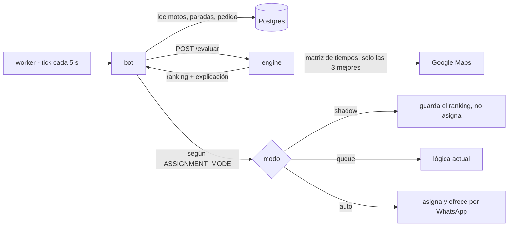

# Algoritmo de asignación

Cómo se conecta al sistema el algoritmo de `algoritmoDeli` (score multi-factor para elegir motorizado) y cómo se prueba de forma aislada. Estado: **implementado con los tres modos. Staging está en `auto` con las motos simuladas del simulador** ([OPERACION.md](OPERACION.md), «Simulador»); falta probarlo con motos reales y GPS. Lo pendiente está en [PLAN.md](PLAN.md), objetivo **D**.

## Idea

El algoritmo se ejecuta como un servicio aparte, **`engine`**, con un solo endpoint: `POST /evaluar`. Recibe una foto del momento (motos, paradas pendientes, pedido nuevo, configuración) y devuelve el ranking con la explicación. No toca la base de datos ni WhatsApp y no guarda estado.

El código actual (`simulador/algoritmo.py`, ~210 líneas, solo librería estándar) ya es una función pura con la función de tiempo intercambiable, así que no hay que reescribirlo, solo envolverlo.



- **El bot arma la foto y decide qué hacer con el resultado.** El engine solo calcula. Ofertas, reintentos y WhatsApp quedan fuera del algoritmo.
- **El mapa solo mide** (km y minutos). El algoritmo decide. Hoy mide el OSRM propio (km por calle) cuando está encendido `settings.routing_config.porCalle`; si no, Haversine × 1,3. Google para las finalistas queda pendiente ([PLAN](PLAN.md) D-3).
- El modo (`queue | shadow | auto`) va en `settings.engine_config`, cambiable sin redesplegar. Por defecto es `shadow`: la cola asigna y el engine solo calcula. En `auto` la cola no asigna nada, y lo que el engine no pueda asignar lo asigna la central a mano. Producción pasa a `auto` cuando el GPS funcione con motos reales y la comparación con la central convenza ([PLAN](PLAN.md) D-4).

## Cómo calcula los tiempos

La función `tiempo(a, b)` es intercambiable:

| Modo (`tiempos`) | Uso |
|---|---|
| `haversine`: línea recta × 1,3 a 25 km/h | Con el interruptor apagado (por defecto), y en las pruebas automáticas y CI: gratis, sin red, reproducible |
| `osrm`: km por calle del OSRM propio a 25 km/h | Con `settings.routing_config.porCalle` encendido. Los mismos km con que el bot cobra el domicilio: precio y asignación miden igual |
| Google Maps | Pendiente: solo para las finalistas ([PLAN](PLAN.md) D-3) |

**Por calle con OSRM** (`apps/engine/calles.py`). El bot manda `tiempos: "osrm"` cuando el interruptor está encendido. El engine pide a OSRM, en **una sola consulta** (`/table`), la distancia por calle entre todos los puntos de la evaluación: el restaurante, el cliente y, de cada moto con señal dentro del radio, su posición y sus paradas pendientes. Cada tramo pasa a minutos con la misma `VELOCIDAD_KMH` de siempre: solo cambia la distancia, no la fórmula del score ni los pesos. El filtro por radio sigue en línea recta.

- **Respaldo:** si OSRM no responde en 1 s, o falla, toda la evaluación usa Haversine × `FACTOR_RUTA`, y durante 30 s no se le vuelve a preguntar. Un tramo sin ruta, o con un punto a más de 500 m de toda calle del mapa, va en línea recta y el resto por calle. Nunca se frena una asignación por OSRM.
- **Qué fuente se usó:** la respuesta trae `tiempos`, que queda en `engine_evaluations.response`:

```jsonc
"tiempos": {
  "pedido": "osrm",                 // lo que pidió el bot: haversine | osrm
  "fuente": "osrm",                 // lo que se usó: osrm | haversine | mixta
  "respaldo": null,                 // por qué no se usó OSRM ("OSRM falló: …", "sin OSRM_URL"…)
  "tramos_calle": 14, "tramos_linea_recta": 0
}
```

  Con `tiempos: "haversine"` es `{"pedido": "haversine", "fuente": "haversine", "respaldo": null}` y la decisión es idéntica a la de antes (`tests/test_calles.py`). La caída también queda en el registro del contenedor (`[calles] …`, ver [OPERACION](OPERACION.md), «Mapa de calles»).

Flujo por pedido para gastar poco en Google:
1. Filtro por radio con Haversine (gratis).
2. Preselección de candidatas, no solo por cercanía, para no dejar fuera a quien la equidad favorece.
3. **Una** matriz a Google para las 3 mejores (`FINALISTAS_GOOGLE`, ajustable en `config`). Con 2 elegibles, para esas 2; con una sola no se consulta: se le asigna directo.
4. El algoritmo puntúa.

Si Google falla o se supera el tope diario, se usa el cálculo por calle de OSRM, y si este falla, Haversine.

*Por verificar antes de construir:* si Google ofrece modo moto (`TWO_WHEELER`) en Colombia, el costo con volumen real y los límites de caché de sus términos.

## Cambios necesarios en el algoritmo

Sobre `simulador/algoritmo.py`, sin cambiar la fórmula del score:

1. **Recibir `ahora` como parámetro.** Hoy `evaluar` llama a `time.time()` y el resultado depende del reloj; así los casos no son reproducibles.
2. **Entrada y salida en JSON.** La función `tiempo` no viaja por HTTP: el engine la construye por dentro según `tiempos`.
3. **Tiempos absolutos.** El pedido y las paradas traen `listo_ts` (hora exacta); el engine calcula los minutos que faltan con `ahora`, como ya hace `para_evaluar` en el simulador.
4. **El modo lo decide la demanda, no la hora.** Antes salía de un horario fijo (pico de 7:00 a 9:30 p.m., hora de Cali). Ahora el bot mide la demanda y manda `modo` en cada petición: alta = `pico`, baja = `valle` (ver «Demanda»). Sin `modo`, el engine usa `valle`; la hora no cuenta.
5. **Cuota justa recibida por moto** (`especificaciones.md`, sección 4.A), en vez del promedio de entregas del grupo, que asume que todas las motos llevan el mismo tiempo conectadas.
6. **Minutos sin pedido desde `disponible_desde_ts`**: la última entrega o la conexión, lo más reciente (sección 4.C). Reemplaza `ultimo_pedido_ts`, que falla si la moto nunca ha recibido un pedido.
7. **Devolver el `plan` de la ganadora**: sus paradas en orden, como datos. Hoy `evaluar` solo da la secuencia como texto y el simulador vuelve a llamar a `mejor_insercion` para obtenerlo.
8. **Motivo de exclusión con código**, además del texto, para que el bot y las estadísticas no dependan de una frase.
9. **Constantes configurables**: todas las del inicio del archivo (`PESOS`, `BETA`, `TAU_MIN`, `D50_MIN`, `R_MAX_MIN`, `MARGEN_DESPACHO_MIN`, `MAX_PEDIDOS`, `S_EQUIDAD`, `T_MAX_ESPERA_MIN`...) en el campo opcional `config`. Por defecto, los valores actuales.
10. **`engine_version` en la respuesta**, y se guarda con cada asignación para poder comparar versiones después.

## Contrato

Acordado el 27 de octubre de 2026. Coordenadas siempre como `[lat, lon]` (en la base son `{lat, lng}`; convierte el bot). Horas en segundos Unix.

### Petición: `POST /evaluar`

```jsonc
{
  "ahora": 1790000000,
  "modo": "pico",                  // pico | valle: lo decide la demanda (ver «Demanda»); sin modo, valle
  "multipedido": true,             // de settings
  "radio_km": 4,                   // de settings
  "pedido": {
    "id": 205,
    "restaurante": [3.4516, -76.5320],
    "cliente": [3.4372, -76.5225], // obligatorio: el bot no evalúa sin ubicación
    "listo_ts": 1790001200         // hora en que la comida está lista
  },
  "motos": [{
    "id": "17",
    "lat": 3.45, "lon": -76.53,
    "sin_senal": false,            // último reporte de Traccar hace 30 s o más
    "entregas": 4,                 // del turno
    "cuota": 3.6,                  // cuota justa acumulada (sección 4.A)
    "disponible_desde_ts": 1789998000,
    "paradas": [                   // pendientes, en el orden en que las hará
      { "tipo": "R", "punto": [3.44, -76.52], "pedido": 101, "listo_ts": 1790000300 },
      { "tipo": "C", "punto": [3.43, -76.51], "pedido": 101 }
    ]
  }],
  "tiempos": "haversine",          // haversine | osrm (km por calle); google, pendiente
  "config": {}                     // opcional: sobrescribe constantes
}
```

| Campo | De dónde sale |
|---|---|
| `pedido.listo_ts` | El restaurante escribe «listo en X min»; el bot lo exige si falta y guarda la hora exacta al recibirlo |
| `pedido.cliente` | Geocodificación de la dirección; obligatorio |
| `motos[].lat`, `lon`, `sin_senal` | Traccar (`couriers.lat`, `lng`, `locationUpdatedAt`) |
| `motos[].cuota` | La lleva el bot: en cada entrega completada, cada moto activa suma 1/N; las pausadas o desconectadas no suman; se reinicia por turno |
| `motos[].paradas` | El `plan` guardado de la última asignación, quitando lo ya hecho. `R` desaparece con el botón «Recogí» y `C` al marcar la entrega |
| `paradas[].listo_ts` | En `R`, cuándo está lista esa comida. En `W`, hasta cuándo se espera al cliente |

Tipos de parada: `R` recoger, `C` entregar, `W` esperar a un cliente que no contesta, `V` devolver al restaurante un pedido no entregado, `B` volver a recogida después de entregar. Hoy el bot no envía `B`: el servicio termina al entregar, y lo que el domiciliario le debe a un restaurante (el datáfono, la plata) es un pendiente de regreso aparte que no lo deja ocupado ([FLUJO-DOMICILIARIO.md](FLUJO-DOMICILIARIO.md), «Pendientes de regreso»). Ya no se supone el regreso después de cada entrega (`asumirRegreso` se quitó); planear cuándo vuelve, según el motivo y la demanda, es la issue #60.

### Respuesta

```jsonc
{
  "engine_version": "2026.11.3",
  "modo": "pico",
  "pesos": [0.70, 0.20, 0.10],
  "despacho": {
    "listo_ts": 1790001200,
    "despachar_ts": 1790000780,    // cuándo debe asignarse el pedido
    "faltan_min": 13.0             // 0 = asignar ya
  },
  "ganador": "17",                 // null si ninguna es elegible
  "plan": [                        // paradas de la ganadora en orden; pedido null = el nuevo
    { "tipo": "R", "punto": [3.4516, -76.5320], "pedido": null, "listo_ts": 1790001200 },
    { "tipo": "R", "punto": [3.44, -76.52], "pedido": 101, "listo_ts": 1790000300 },
    { "tipo": "C", "punto": [3.43, -76.51], "pedido": 101 },
    { "tipo": "C", "punto": [3.4372, -76.5225], "pedido": null }
  ],
  "motos": [{                      // elegibles por score, luego excluidas por distancia
    "id": "17", "elegible": true, "motivo": null, "motivo_texto": null,
    "distancia_km": 1.2, "score": 82.4,
    "f_tiempo": 91.0, "f_ruta": 70.7, "f_equidad": 55.1, "f_carga": 54.0, "f_espera": 60.0,
    "t_a_min": 6.1, "g_min": -1.9, "desvio_min": 2.0, "min_sin_pedido": 0.0,
    "secuencia": "Recoge nuevo → Recoge #101 → Entrega #101 → Entrega nuevo",
    "ruta_puntos": [[3.45, -76.53], [3.4516, -76.5320]]
  }],
  "explicacion": "Servicio asignado a 17 por tiempo de llegada al restaurante (82.4 vs 64.0 de 9)",
  "tiempos": { "pedido": "haversine", "fuente": "haversine", "respaldo": null }  // ver «Cómo calcula los tiempos»
}
```

Códigos de `motivo`: `sin_senal`, `fuera_radio`, `cliente_no_contesta`, `ocupada_sin_multipedido`, `capacidad`, `retraso`.

### Qué hace el bot con la respuesta

- **`faltan_min = 0`**: asigna a `ganador`, guarda el `plan` y arma la ficha del motorizado con ese orden.
- **`faltan_min > 0`**: no asigna, gane una moto libre u ocupada (la espera es del pedido, como en el simulador). Programa una revisión unos 2 min antes de `despachar_ts`, para dar tiempo a que el motorizado acepte la oferta.
- **Mientras espera**, recalcula con `haversine` en cada tick del worker (cada 5 s), con las posiciones actuales del GPS. No cuesta nada y cubre que una moto libre se aleje: el engine supone que las libres esperan quietas, y en la calle no es así. Si el resultado adelanta `despachar_ts`, adelanta la revisión; si ya llegó, asigna en ese tick.
- **En la revisión**, una sola consulta con `google` para las finalistas y asigna a la que gane en ese momento, aunque vaya un poco tarde: no se vuelve a preguntar. Si la ganadora no acepta, se ofrece a la siguiente con los mismos tiempos; solo si ninguna de las finalistas acepta se consulta otra vez.
- Al restaurante solo se le informa el costo del domicilio (`especificaciones.md`, sección 1), así que la espera no cambia nada para él.
- En modo `shadow` hace todo lo anterior, pero solo guarda a quién y cuándo habría asignado.

### Lo que el bot tiene que aportar

Hoy no existe y el engine lo necesita:

1. ~~Exigir y extraer el tiempo de preparación (`services/openai/extract.ts`) y guardarlo como hora exacta en el viaje.~~ Hecho: es un dato obligatorio más (`listoEnMinutos`) y se guarda en `trips.ready_at`, contado desde el mensaje que lo dijo.
2. ~~Geocodificar la dirección del cliente y no evaluar sin coordenadas.~~ Hecho con Google Geocoding (`services/google/geocode.ts`): si no la ubica con precisión, se le pide corregir al restaurante y luego pasa a un asesor. Sin `GOOGLE_MAPS_API_KEY`, o si Google falla, el viaje sale sin coordenadas.
3. ~~Botón «Recogí» para el motorizado.~~ Hecho (ver [FLUJO-DOMICILIARIO.md](FLUJO-DOMICILIARIO.md)).
4. ~~Guardar el `plan` de cada asignación, para armar las `paradas`.~~ Hecho: `courier_routes` guarda el orden y lo pendiente sale de la fase de cada viaje.
5. Llevar la `cuota` por moto y la hora de la última entrega o conexión. Pendiente ([PLAN](PLAN.md) D-2): hoy se manda el promedio de entregas del grupo.
6. ~~Recibir las posiciones y marcar `sin_senal` tras 30 s sin reporte.~~ Hecho (issue #42). La app debe reportar aunque la moto esté quieta, o la moto cuenta como sin señal.
7. ~~El modo, `radio_km` y `multipedido` en `settings`.~~ Hecho: `settings.engine_config` (ver «Modo sombra»).

## Modo sombra

Implementado en `apps/bot/src/dispatch/engine.ts` y corriendo en cada tick del worker, después de la asignación real (`/api/internal/tick`). La cola sigue asignando; el engine calcula al lado y no envía nada.

- **Qué evalúa:** los viajes abiertos de las últimas 3 horas. Mientras faltan minutos para despacharlos, se reevalúan en cada tick con Haversine; cuando el engine diría «ya», se congela la decisión.
- **Dónde queda:** tabla `engine_evaluations`, una fila por viaje: `waiting` (aún no es hora, faltan datos o no hay motos, con el motivo en `reason`), `decided` (moto en `courier_id`, hora en `decided_at`) o `expired` (el viaje se cerró o pasaron 3 horas sin decidir). Guarda la última petición y respuesta de `/evaluar`, para explicar la decisión y repetirla con otra versión del engine, y con qué modo se evaluó (`mode`) y la demanda de ese momento (`demand`: nivel y números).
- **Cómo se activa:** `ENGINE_URL` en el bot (en los compose apunta a `http://engine:3003`) y `settings.engine_config` con `mode = "shadow"`, que es el valor por defecto. Con `mode = "queue"` no corre. Ahí mismo van `radioKm` (4) y `multipedido` (true). Una moto sin reporte de GPS en los últimos 30 segundos va con `sin_senal` y no participa; ese límite es fijo (`NO_SIGNAL_MS` en `packages/shared/src/domain/gps.ts`), el mismo con el que el portal la muestra «sin señal».
- **Si el engine falla**, se registra en `reason`, se reintenta en el siguiente tick y la asignación real no se entera.

Comparar con lo que pasó de verdad:

```sql
select t.code, sombra.name as engine_habria, a.courier_name as asignado_real,
       e.faltan_min, e.decided_at, e.engine_version
from engine_evaluations e
join trips t on t.id = e.trip_id
left join couriers sombra on sombra.id = e.courier_id
left join assignments a on a.trip_id = e.trip_id
where e.status = 'decided'
order by e.decided_at desc;
```

Lo que todavía se aproxima, hasta que el bot aporte el dato:

| Falta | Mientras tanto |
|---|---|
| Posición real de las motos (Traccar) | Sin GPS reciente toda moto cuenta como `sin_senal`: el engine no elige a nadie y la fila queda `waiting` con «Sin motos elegibles» |
| Cuota 1/N del turno | Promedio de entregas del grupo |
| Decisiones encadenadas | Cada viaje se evalúa contra las asignaciones reales: lo que el engine «habría asignado» antes no ocupa a esa moto para el siguiente |

## Modo `auto`

El engine asigna de verdad, en cada tick, los pedidos pendientes, del más viejo al más nuevo:

- **Si ya es hora** (`faltan_min = 0`): asigna a la ganadora, libre u ocupada, y guarda su ruta. Al confirmar se intenta de una vez, para que el restaurante reciba un solo mensaje con quién va.
- **Si falta** (`faltan_min > 0`): espera. El restaurante ya tiene su confirmación, sin disculpas, porque la espera es a propósito.
- **Sin ganadora o con el engine caído:** sigue pendiente con el motivo a la vista en el tablero («Sin motos elegibles (sin GPS: 6)»), y la central lo asigna a mano.

Hoy se asigna directo, sin oferta ni rechazo. Cómo activarlo, cuando llegue el momento:

```sql
insert into settings (key, value) values ('engine_config', '{"mode":"auto"}')
on conflict (key) do update set value = settings.value || excluded.value;
```

## Demanda

El algoritmo trabaja en dos modos. **Pico** prioriza la rapidez y deja llevar hasta 3 pedidos por moto; **valle** reparte el trabajo parejo y deja llevar hasta 2. El modo ya no depende de la hora: lo decide la demanda, que el sistema mide en vivo con lo que está pasando. **Demanda alta = pico, demanda baja = valle.** Los pesos, la capacidad y el resto de las constantes de cada modo no cambian. No hay botón para forzarla, y es una sola para toda la operación (no por zona).

Código: el cálculo, puro y con pruebas, en `packages/shared/src/domain/demand.ts`; la medición en la base y lo que se guarda, en `packages/shared/src/db/demand.ts`. La corre el tick (`/api/internal/tick`) cada 5 s, antes del engine, que evalúa en ese mismo tick con el modo que sale de ella.

### Qué se mide

| Número | Qué cuenta |
|---|---|
| **Esperando** | Pedidos pendientes (sin moto) cuya comida está lista o lo estará dentro del horizonte (10 min). Uno sin hora de listo cuenta como listo. Los que tienen la comida para más tarde se muestran aparte y no cuentan: todavía no le piden moto a nadie, y en `auto` el engine los retiene a propósito |
| **Entraron** | Pedidos creados en la ventana (15 min), sin los cancelados: el ritmo, que avisa antes de que se acumulen |
| **Motos que cuentan** | Conectadas (disponibles u ocupadas, activas) con el GPS en vivo, las mismas que puede elegir el algoritmo. Si ninguna tiene GPS (operación sin GPS todavía), todas las conectadas, para no marcar alta solo porque falta el GPS |
| **Libres** | De las que cuentan, las que no llevan ningún pedido. Una ocupada con espacio no cuenta como libre: su espacio depende del modo (3 en pico, 2 en valle), y contarla haría que el modo se midiera a sí mismo |

### La fórmula

En cada medición:

- **Pide subir** si los pedidos esperando llegan a `max(3, 2 × motos libres)`, **o** si los que entraron en 15 min llegan a `max(4, 1 × motos que cuentan)` y quedan pocas libres (la mitad o menos de las que cuentan).
- **Pide bajar** si los esperando están por debajo de la mitad de su umbral y, además, el ritmo también lo está o hay más de la mitad de las motos libres. Con muchas libres, los pedidos que entran se atienden enseguida aunque la ventana todavía los cuente (sin esta regla, en la prueba con docker compose seguía en alta con nada esperando y 6 de 8 motos libres).
- **Entre medio** no pide nada: el hueco entre subir y bajar es lo que evita que cambie a cada rato.

El nivel cambia solo si la medición lo pide **sin cortarse**: **3 minutos** para subir y **10 minutos** para bajar. Un momento en el que deja de pedirlo vuelve a empezar la cuenta, y si el tick deja de medir más de un minuto, lo acumulado no cuenta. Bajar tarda más que subir a propósito: una racha de pedidos se atiende enseguida, y un minuto tranquilo en plena hora de comida no es el fin del turno.

Ejemplos con los valores iniciales:

| Situación | Resultado |
|---|---|
| 1 pedido esperando, 1 moto libre | No sube: no llega al mínimo de 3 |
| 5 esperando, 1 libre | Pide subir (5 ≥ 3); a los 3 min seguidos, alta |
| 4 esperando, 3 libres | Entre medio (4 < 6 para subir, 4 ≥ 3 para bajar): se queda como esté |
| 4 motos, 2 libres, 5 pedidos entraron en 15 min, ninguno esperando | Pide subir por el ritmo (5 ≥ 4, con la mitad libres) |
| 8 motos, 6 libres, 8 entraron en 15 min, ninguno esperando | Pide bajar: con tantas libres el ritmo no pesa |
| En alta: 1 esperando, 2 libres, 1 entró | Pide bajar; a los 10 min seguidos, baja |

**El horario no se usa**, tampoco con pocos datos. Con una sola moto los mínimos (3 esperando, 4 entrando) ya impiden que un pedido suelto la suba, y sin motos conectadas tres pedidos esperando sí es alta, a cualquier hora. Antes de la primera medición es baja.

### Umbrales

Se cambian en el portal, en **Demanda** (`/demanda`), sin desplegar. Se guardan en `settings.demand_config` y el siguiente tick ya los usa:

| Campo | Inicial | Qué es |
|---|---|---|
| `waitingPerFree` | 2 | Pedidos esperando por cada moto libre para subir |
| `minWaiting` | 3 | Mínimo de pedidos esperando para subir |
| `arrivalsPerCourier` | 1 | Pedidos que entran en la ventana por cada moto que cuenta |
| `minArrivals` | 4 | Mínimo de pedidos entrando para subir |
| `windowMin` | 15 | La ventana de los que entran, en minutos |
| `horizonMin` | 10 | Un pendiente cuenta como esperando si su comida está lista dentro de estos minutos |
| `riseMin` | 3 | Minutos seguidos pidiendo subir para subir |
| `fallMin` | 10 | Minutos seguidos pidiendo bajar para bajar |

La fracción para bajar (la mitad del umbral de subida, `FALL_FRACTION`) y la de «pocas motos libres» (la mitad o menos, `FEW_FREE_FRACTION`) son fijas.

### Dónde se ve y qué queda

- **Portal, tablero de viajes:** arriba, una barra con el nivel y el porqué, por ejemplo «Demanda alta · 5 pedidos esperando, 1 moto libre · 7 entraron en 15 min con 3 motos», desde hace cuánto y, si viene cambiando, «Sube a alta en 2 min si sigue así». Si el tick no ha medido en el último minuto, lo dice («sin medir: revisa el worker»). Lleva a `/demanda`.
- **Portal, `/demanda`:** el nivel y el modo del algoritmo, los cuatro números, qué pide la medición de ahora, los umbrales (con lo que significan con las motos de ahora) y el registro de cambios: hora, si subió o bajó, con qué números y cuánto duró el nivel anterior.
- **Base:** `demand_state` (una fila: el nivel, desde cuándo, la cuenta en curso y la última medición) y `demand_changes` (cada cambio, con sus números y los umbrales de ese momento, para calibrar con datos reales). Cada evaluación del engine guarda `mode` y `demand` en `engine_evaluations`.
- **Para el resto del sistema:** `getDemandLevel()` (alta o baja) y `getDemand()` (con su porqué), en `@dispatch/shared/db`. Los usarán los regresos al restaurante y el reclamo de un restaurante.

Calibrar con lo que pasó:

```sql
select at at time zone 'America/Bogota' as hora, previous || ' → ' || level as cambio,
       metrics->>'waiting' as esperando, metrics->>'free' as libres,
       metrics->>'arrivals' as entraron, metrics->>'counted' as motos
from demand_changes order by at desc limit 50;

-- Con qué modo salieron las evaluaciones de hoy
select mode, demand->>'level' as demanda, count(*)
from engine_evaluations where updated_at > now() - interval '1 day' group by 1, 2;
```

## Cómo se prueba

Tres capas, de la más barata a la más real:

1. **Casos con `assert` en CI.** Cada caso es un JSON en `casos/` con motos, pedidos y, opcionalmente, qué moto debería ganar. Corren con Haversine, sin red ni Google, en cada PR. Si un cambio de pesos rompe un caso, el PR falla. Agregar un escenario (hora pico, valle, moto sin señal, multipedido, equidad) es agregar un archivo, sin código.
2. **Simulador contra el engine.** El simulador deja de importar `algoritmo.py` y llama a `POST /evaluar`, igual que producción: lo que se ve ahí es el mismo código del sistema. Puede usar Google para calibrar con tiempos reales.
3. **Modo sombra en staging, luego replay.** El engine calcula sobre pedidos reales, el bot guarda «habría asignado a X» y la asignación real sigue como hoy. Se compara con lo que decidió el despachador. Después, replay con historial real del cliente y piloto.

## Ubicación en el repo

```
apps/engine/
  algoritmo.py     # el actual, casi sin cambios
  api.py           # /evaluar y /health
  casos/           # los JSON de prueba
  tests/           # asserts sobre los casos
  Dockerfile
simulador/         # interfaz web; apunta al engine
```

Mismo repo para tener un solo CI, un solo despliegue por commit y el contrato versionado junto a quien lo consume. En despliegue es una imagen más (`dispatch-engine:<hash>`) y un servicio en `compose.yml` **sin puerto público**: solo el bot lo alcanza por la red interna. Repo aparte solo si el ciclo de cambios fuera muy distinto.

## Orden de implementación

1. ~~Escribir y acordar el contrato JSON.~~ Hecho (ver «Contrato»).
2. ~~`engine` con Haversine y los casos como tests en CI (sin Google).~~ Hecho: `apps/engine`, imagen `dispatch-engine` y job en `ci.yml`.
3. ~~El bot llama al engine en modo `shadow` y guarda el ranking.~~ Hecho (ver «Modo sombra»). Decide de verdad cuando haya GPS.
4. ~~Km por calle con OSRM propio, con respaldo a Haversine.~~ Hecho (`apps/engine/calles.py`, interruptor `settings.routing_config.porCalle`).
5. Google Maps para las 3 mejores, con respaldo a OSRM ([PLAN](PLAN.md) D-3).
6. ~~GPS: identificadores aleatorios por moto; el receptor descarta los no registrados.~~ Hecho (`/api/gps`). Falta instalarlo en los celulares ([PLAN](PLAN.md) D-1).
7. ~~Modo `auto`.~~ Hecho (`apps/bot/src/dispatch/engine.ts`). Probado en staging con el simulador; falta probarlo en la calle.
8. Comparar con la realidad y pasar a `auto` cuando los números convenzan ([PLAN](PLAN.md) D-4).

## Pendientes por decidir

- Si el simulador sigue con OSRM o pasa a Google para calibrar.
- Si una oferta que vence sin respuesta cuenta en la equidad (`especificaciones.md`, 4.B, dice que sí). Se decide con el flujo de ofertas, que el bot todavía no tiene: hoy asigna directo.
- Los pendientes con el cliente de la sección 7 de `especificaciones.md` (base de efectivo, zonas por domiciliario, reasignaciones, capacidad en valle).

Resuelto: los rechazos justificados no cuentan en la equidad (`p_r = 0`), como dice `especificaciones.md`.

Resuelto: la lógica actual en TypeScript convive con el engine durante el modo sombra y queda como respaldo hasta pasar a `auto`.
