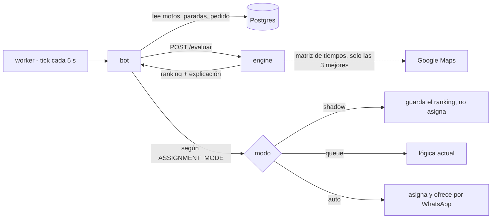

# Algoritmo de asignación

Cómo se conecta al sistema el algoritmo de `algoritmoDeli` (score multi-factor para elegir motorizado) y cómo se prueba de forma aislada. Estado: **diseño acordado, sin implementar**.

## Idea

El algoritmo se ejecuta como un servicio aparte, **`engine`**, con un solo endpoint: `POST /evaluar`. Recibe una foto del momento (motos, paradas pendientes, pedido nuevo, configuración) y devuelve el ranking con la explicación. No toca la base de datos ni WhatsApp y no guarda estado.

El código actual (`simulador/algoritmo.py`, ~210 líneas, solo librería estándar) ya es una función pura con la función de tiempo intercambiable, así que no hay que reescribirlo, solo envolverlo.



- **El bot arma la foto y decide qué hacer con el resultado.** El engine solo calcula. Ofertas, reintentos y WhatsApp quedan fuera del algoritmo.
- **Google Maps solo mide** (minutos y km). El algoritmo decide.
- `ASSIGNMENT_MODE = queue | shadow | auto` en la tabla `settings`, cambiable sin redesplegar. Se empieza en `shadow`. La lógica actual en TypeScript convive como respaldo hasta pasar a `auto`.

## Cómo calcula los tiempos

La función `tiempo(a, b)` es intercambiable:

| Modo | Uso |
|---|---|
| Haversine × 1,3 a 25 km/h | Pruebas automáticas y CI: gratis, sin red, reproducible |
| Google Maps | Staging y producción; también calibración en el simulador |

Flujo por pedido para gastar poco en Google:
1. Filtro por radio con Haversine (gratis).
2. Preselección de candidatas, no solo por cercanía, para no dejar fuera a quien la equidad favorece.
3. **Una** matriz a Google para las 3 mejores.
4. El algoritmo puntúa.

Si Google falla o se supera el tope diario, se usa Haversine. OSRM queda fuera del sistema: solo fue un sustituto gratuito dentro del simulador.

*Por verificar antes de construir:* si Google ofrece modo moto (`TWO_WHEELER`) en Colombia, el costo con volumen real y los límites de caché de sus términos.

## Cambios necesarios en el algoritmo

Sobre `simulador/algoritmo.py`, sin cambiar la fórmula del score:

1. **Recibir `ahora` como parámetro.** Hoy `evaluar` llama a `time.time()` y el resultado depende del reloj; así los casos no son reproducibles.
2. **Entrada y salida en JSON.** La función `tiempo` no viaja por HTTP: el engine la construye por dentro según `tiempos`.
3. **Tiempos absolutos.** El pedido y las paradas traen `listo_ts` (hora exacta); el engine calcula los minutos que faltan con `ahora`, como ya hace `para_evaluar` en el simulador.
4. **Modo por la hora de Cali.** Si no se fuerza `modo`, sale de `ahora` en `America/Bogota`. Hoy `modo_por_hora()` usa la hora local del servidor, que está en Núremberg.
5. **Cuota justa recibida por moto** (`especificaciones.md`, sección 4.A), en vez del promedio de entregas del grupo, que asume que todas las motos llevan el mismo tiempo conectadas.
6. **Minutos sin pedido desde `disponible_desde_ts`**: la última entrega o la conexión, lo más reciente (sección 4.C). Reemplaza `ultimo_pedido_ts`, que falla si la moto nunca ha recibido un pedido.
7. **Devolver el `plan` de la ganadora**: sus paradas en orden, como datos. Hoy `evaluar` solo da la secuencia como texto y el simulador vuelve a llamar a `mejor_insercion` para obtenerlo.
8. **Motivo de exclusión con código**, además del texto, para que el bot y las estadísticas no dependan de una frase.
9. **Constantes configurables**: todas las del inicio del archivo (`PESOS`, `BETA`, `TAU_MIN`, `D50_MIN`, `R_MAX_MIN`, `MARGEN_DESPACHO_MIN`, `MAX_PEDIDOS`, `S_EQUIDAD`, `T_MAX_ESPERA_MIN`, `HORARIO_PICO`...) en el campo opcional `config`. Por defecto, los valores actuales.
10. **`engine_version` en la respuesta**, y se guarda con cada asignación para poder comparar versiones después.

## Contrato

Acordado el 27 de octubre de 2026. Coordenadas siempre como `[lat, lon]` (en la base son `{lat, lng}`; convierte el bot). Horas en segundos Unix.

### Petición: `POST /evaluar`

```jsonc
{
  "ahora": 1790000000,
  "modo": null,                    // pico | valle | null = según la hora de Cali
  "multipedido": true,             // de settings
  "radio_km": 4,                   // de settings
  "pedido": {
    "id": 205,
    "restaurante": [3.4516, -76.5320],
    "cliente": [3.4372, -76.5225], // obligatorio: el bot no evalúa sin ubicación
    "listo_ts": 1790001200         // hora en que la comida está lista
  },
  "motos": [{
    "id": "17",
    "lat": 3.45, "lon": -76.53,
    "sin_senal": false,            // último reporte de Traccar hace más de 2 min
    "entregas": 4,                 // del turno
    "cuota": 3.6,                  // cuota justa acumulada (sección 4.A)
    "disponible_desde_ts": 1789998000,
    "paradas": [                   // pendientes, en el orden en que las hará
      { "tipo": "R", "punto": [3.44, -76.52], "pedido": 101, "listo_ts": 1790000300 },
      { "tipo": "C", "punto": [3.43, -76.51], "pedido": 101 }
    ]
  }],
  "tiempos": "haversine",          // haversine | google
  "config": {}                     // opcional: sobrescribe constantes
}
```

| Campo | De dónde sale |
|---|---|
| `pedido.listo_ts` | El restaurante escribe «listo en X min»; el bot lo exige si falta y guarda la hora exacta al recibirlo |
| `pedido.cliente` | Geocodificación de la dirección; obligatorio |
| `motos[].lat`, `lon`, `sin_senal` | Traccar (`couriers.lat`, `lng`, `locationUpdatedAt`) |
| `motos[].cuota` | La lleva el bot: en cada entrega completada, cada moto activa suma 1/N; las pausadas o desconectadas no suman; se reinicia por turno |
| `motos[].paradas` | El `plan` guardado de la última asignación, quitando lo ya hecho. `R` desaparece con el botón «Recogido» y `C` con «Entregado» |
| `paradas[].listo_ts` | En `R`, cuándo está lista esa comida. En `W`, hasta cuándo se espera al cliente |

Tipos de parada: `R` recoger, `C` entregar, `W` esperar a un cliente que no contesta, `V` devolver al restaurante.

### Respuesta

```jsonc
{
  "engine_version": "2026.10.1",
  "modo": "pico",
  "pesos": [0.70, 0.20, 0.10],
  "despacho": {
    "listo_ts": 1790001200,
    "despachar_ts": 1790000780,    // cuándo debe asignarse el pedido
    "faltan_min": 13.0             // 0 = asignar ya
  },
  "ganador": "17",                 // null si ninguna es elegible
  "plan": [                        // paradas de la ganadora en orden; pedido null = el nuevo
    { "tipo": "R", "punto": [3.4516, -76.5320], "pedido": null, "listo_ts": 1790001200 },
    { "tipo": "R", "punto": [3.44, -76.52], "pedido": 101, "listo_ts": 1790000300 },
    { "tipo": "C", "punto": [3.43, -76.51], "pedido": 101 },
    { "tipo": "C", "punto": [3.4372, -76.5225], "pedido": null }
  ],
  "motos": [{                      // elegibles por score, luego excluidas por distancia
    "id": "17", "elegible": true, "motivo": null, "motivo_texto": null,
    "distancia_km": 1.2, "score": 82.4,
    "f_tiempo": 91.0, "f_ruta": 70.7, "f_equidad": 55.1, "f_carga": 54.0, "f_espera": 60.0,
    "t_a_min": 6.1, "g_min": -1.9, "desvio_min": 2.0, "min_sin_pedido": 0.0,
    "secuencia": "Recoge nuevo → Recoge #101 → Entrega #101 → Entrega nuevo",
    "ruta_puntos": [[3.45, -76.53], [3.4516, -76.5320]]
  }],
  "explicacion": "Servicio asignado a 17 por tiempo de llegada al restaurante (82.4 vs 64.0 de 9)"
}
```

Códigos de `motivo`: `sin_senal`, `fuera_radio`, `cliente_no_contesta`, `ocupada_sin_multipedido`, `capacidad`, `retraso`.

### Qué hace el bot con la respuesta

- **`faltan_min = 0`**: asigna a `ganador`, guarda el `plan` y arma la ficha del motorizado con ese orden.
- **`faltan_min > 0`**: no asigna, gane una moto libre u ocupada (la espera es del pedido, como en el simulador). Programa una revisión unos 2 min antes de `despachar_ts`, para dar tiempo a que el motorizado acepte la oferta.
- **Mientras espera**, solo recalcula con `haversine` cuando cambia algo: se libera una moto, entra otro pedido, el restaurante cambia el tiempo. Si el resultado adelanta `despachar_ts`, adelanta la revisión.
- **En la revisión**, consulta con `google` y asigna a la que gane en ese momento. Son unas 2 consultas a Google por pedido.
- Al restaurante solo se le informa el costo del domicilio (`especificaciones.md`, sección 1), así que la espera no cambia nada para él.
- En modo `shadow` hace todo lo anterior, pero solo guarda a quién y cuándo habría asignado.

### Lo que el bot tiene que aportar

Hoy no existe y el engine lo necesita:

1. ~~Exigir y extraer el tiempo de preparación (`services/openai/extract.ts`) y guardarlo como hora exacta en el viaje.~~ Hecho: es un dato obligatorio más (`listoEnMinutos`) y se guarda en `trips.ready_at`, contado desde el mensaje que lo dijo.
2. ~~Geocodificar la dirección del cliente y no evaluar sin coordenadas.~~ Hecho con Google Geocoding (`services/google/geocode.ts`): si no la ubica con precisión, se le pide corregir al restaurante y luego pasa a un asesor. Sin `GOOGLE_MAPS_API_KEY`, o si Google falla, el viaje sale sin coordenadas.
3. Botón «Recogido» para el motorizado.
4. Guardar el `plan` de cada asignación, para armar las `paradas`.
5. Llevar la `cuota` por moto y la hora de la última entrega o conexión.
6. Recibir las posiciones de Traccar y marcar `sin_senal` tras 2 min sin reporte.
7. `ASSIGNMENT_MODE`, `radio_km` y `multipedido` en `settings`.

## Cómo se prueba

Tres capas, de la más barata a la más real:

1. **Casos con `assert` en CI.** Cada caso es un JSON en `casos/` con motos, pedidos y, opcionalmente, qué moto debería ganar. Corren con Haversine, sin red ni Google, en cada PR. Si un cambio de pesos rompe un caso, el PR falla. Agregar un escenario (hora pico, valle, moto sin señal, multipedido, equidad) es agregar un archivo, sin código.
2. **Simulador contra el engine.** El simulador deja de importar `algoritmo.py` y llama a `POST /evaluar`, igual que producción: lo que se ve ahí es el mismo código del sistema. Puede usar Google para calibrar con tiempos reales.
3. **Modo sombra en staging, luego replay.** El engine calcula sobre pedidos reales, el bot guarda «habría asignado a X» y la asignación real sigue como hoy. Se compara con lo que decidió el despachador. Después, replay con historial real del cliente y piloto.

## Ubicación en el repo

```
apps/engine/
  algoritmo.py     # el actual, casi sin cambios
  api.py           # /evaluar y /health
  casos/           # los JSON de prueba
  tests/           # asserts sobre los casos
  Dockerfile
simulador/         # interfaz web; apunta al engine
```

Mismo repo para tener un solo CI, un solo despliegue por commit y el contrato versionado junto a quien lo consume. En despliegue es una imagen más (`dispatch-engine:<hash>`) y un servicio en `compose.yml` **sin puerto público**: solo el bot lo alcanza por la red interna. Repo aparte solo si el ciclo de cambios fuera muy distinto.

## Orden de implementación

1. ~~Escribir y acordar el contrato JSON.~~ Hecho (ver «Contrato»).
2. ~~`engine` con Haversine y los casos como tests en CI (sin Google).~~ Hecho: `apps/engine`, imagen `dispatch-engine` y job en `ci.yml`.
3. El bot llama al engine en modo `shadow` y guarda el ranking. **Primera versión útil.**
4. Google Maps para las 3 mejores, con respaldo a Haversine.
5. GPS real (Traccar): identificadores aleatorios por moto (`moto-7f3k9q`); el receptor descarta los no registrados.
6. Comparar con la realidad y pasar a `queue` o `auto` cuando los números convenzan.

## Pendientes por decidir

- Si el simulador sigue con OSRM o pasa a Google para calibrar.
- Si las ofertas rechazadas o vencidas cuentan en la equidad (`p_r` en la sección 4.B de `especificaciones.md`; hoy no entran en el contrato).
- Los pendientes con el cliente de la sección 7 de `especificaciones.md` (base de efectivo, zonas por domiciliario, reasignaciones, capacidad en valle).

Resuelto: la lógica actual en TypeScript convive con el engine durante el modo sombra y queda como respaldo hasta pasar a `auto`.
