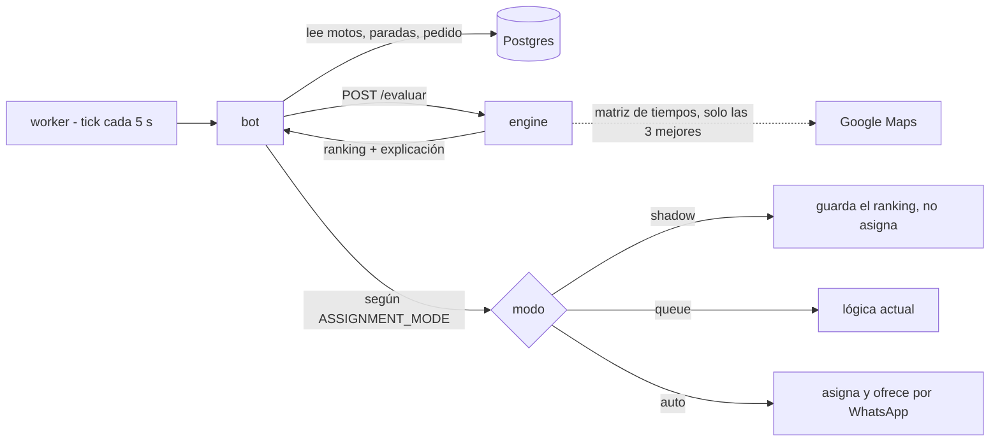

# Algoritmo de asignación

Cómo se conecta al sistema el algoritmo de `algoritmoDeli` (score multi-factor para elegir motorizado) y cómo se prueba de forma aislada. Estado: **diseño acordado, sin implementar**.

## Idea

El algoritmo se ejecuta como un servicio aparte, **`engine`**, con un solo endpoint: `POST /evaluar`. Recibe una foto del momento (motos, paradas pendientes, pedido nuevo, configuración) y devuelve el ranking con la explicación. No toca la base de datos ni WhatsApp y no guarda estado.

El código actual (`simulador/algoritmo.py`, ~210 líneas, solo librería estándar) ya es una función pura con la función de tiempo intercambiable, así que no hay que reescribirlo, solo envolverlo.



- **El bot arma la foto y decide qué hacer con el resultado.** El engine solo calcula. Ofertas, reintentos y WhatsApp quedan fuera del algoritmo.
- **Google Maps solo mide** (minutos y km). El algoritmo decide.
- `ASSIGNMENT_MODE = queue | shadow | auto` en la tabla `settings`, cambiable sin redesplegar. Se empieza en `shadow`. La lógica actual en TypeScript convive como respaldo hasta pasar a `auto`.

## Cómo calcula los tiempos

La función `tiempo(a, b)` es intercambiable:

| Modo | Uso |
|---|---|
| Haversine × 1,3 a 25 km/h | Pruebas automáticas y CI: gratis, sin red, reproducible |
| Google Maps | Staging y producción; también calibración en el simulador |

Flujo por pedido para gastar poco en Google:
1. Filtro por radio con Haversine (gratis).
2. Preselección de candidatas, no solo por cercanía, para no dejar fuera a quien la equidad favorece.
3. **Una** matriz a Google para las 3 mejores.
4. El algoritmo puntúa.

Si Google falla o se supera el tope diario, se usa Haversine. OSRM queda fuera del sistema: solo fue un sustituto gratuito dentro del simulador.

*Por verificar antes de construir:* si Google ofrece modo moto (`TWO_WHEELER`) en Colombia, el costo con volumen real y los límites de caché de sus términos.

## Cambios necesarios en el algoritmo

1. **Recibir `ahora` como parámetro.** Hoy `evaluar` llama a `time.time()` y el resultado depende del reloj; así los casos no son reproducibles.
2. **Entrada y salida en JSON.** La función `tiempo` no viaja por HTTP: el engine la construye por dentro según el modo, o recibe una matriz ya calculada.
3. **Constantes configurables** (pesos, `TAU`, `R_MAX`, `D50`...) en un campo opcional `config` de la petición, para probar variantes sin tocar el código. Por defecto, los valores actuales.
4. **`engine_version` en la respuesta**, y se guarda con cada asignación para poder comparar versiones después.

## Contrato (a definir con quien hizo el algoritmo)

Es lo único que hay que acordar antes de escribir código. Borrador:

```jsonc
// POST /evaluar
{
  "ahora": 1790000000,
  "modo": "pico",                  // pico | valle
  "multipedido": true,
  "radio_km": 4,
  "restaurante": [3.4516, -76.5320],
  "cliente": [3.4372, -76.5225],
  "t_listo": 8,                    // minutos hasta que el pedido está listo
  "motos": [{
    "id": "m1", "lat": 3.45, "lon": -76.53, "sin_senal": false,
    "entregas": 4, "ultimo_pedido_ts": 1789998000,
    "paradas": [{ "tipo": "C", "punto": [3.44, -76.52], "pedido": 101 }]
  }],
  "tiempos": "haversine",          // haversine | google
  "config": {}                     // sobrescribe constantes, opcional
}
// Respuesta: { "motos": [ranking con score, factores y motivo de exclusión],
//              "pesos": [...], "cuota": 3.2, "explicacion": "...", "engine_version": "..." }
```

## Cómo se prueba

Tres capas, de la más barata a la más real:

1. **Casos con `assert` en CI.** Cada caso es un JSON en `casos/` con motos, pedidos y, opcionalmente, qué moto debería ganar. Corren con Haversine, sin red ni Google, en cada PR. Si un cambio de pesos rompe un caso, el PR falla. Agregar un escenario (hora pico, valle, moto sin señal, multipedido, equidad) es agregar un archivo, sin código.
2. **Simulador contra el engine.** El simulador deja de importar `algoritmo.py` y llama a `POST /evaluar`, igual que producción: lo que se ve ahí es el mismo código del sistema. Puede usar Google para calibrar con tiempos reales.
3. **Modo sombra en staging, luego replay.** El engine calcula sobre pedidos reales, el bot guarda «habría asignado a X» y la asignación real sigue como hoy. Se compara con lo que decidió el despachador. Después, replay con historial real del cliente y piloto.

## Ubicación en el repo

```
apps/engine/
  algoritmo.py     # el actual, casi sin cambios
  api.py           # /evaluar y /health
  casos/           # los JSON de prueba
  tests/           # asserts sobre los casos
  Dockerfile
simulador/         # interfaz web; apunta al engine
```

Mismo repo para tener un solo CI, un solo despliegue por commit y el contrato versionado junto a quien lo consume. En despliegue es una imagen más (`dispatch-engine:<hash>`) y un servicio en `compose.yml` **sin puerto público**: solo el bot lo alcanza por la red interna. Repo aparte solo si el ciclo de cambios fuera muy distinto.

## Orden de implementación

1. Escribir y acordar el contrato JSON.
2. `engine` con Haversine y los casos como tests en CI (sin Google).
3. El bot llama al engine en modo `shadow` y guarda el ranking. **Primera versión útil.**
4. Google Maps para las 3 mejores, con respaldo a Haversine.
5. GPS real (Traccar): identificadores aleatorios por moto (`moto-7f3k9q`); el receptor descarta los no registrados.
6. Comparar con la realidad y pasar a `queue` o `auto` cuando los números convenzan.

## Pendientes por decidir

- Si el engine reemplaza por completo la lógica actual en TypeScript o convive con ella (recomendado: conviven durante el modo sombra).
- Si el simulador sigue con OSRM o pasa a Google para calibrar.
- Detalles del contrato con quien hizo el algoritmo.
