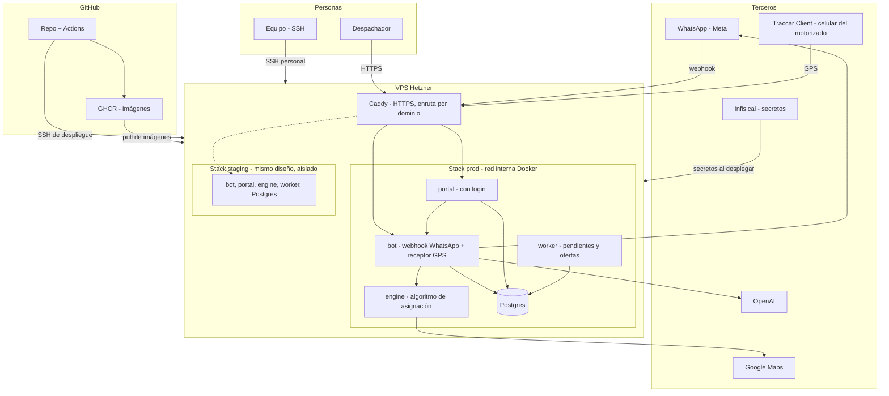

# Infraestructura

Estado: **decidido, aún no implementado**. Hoy el sistema corre en Vercel + Neon + Infisical. Este documento describe el destino: todo en un VPS de Hetzner.

## Diagrama de arquitectura

El restaurante y el motorizado solo hablan con WhatsApp. El motor (`engine`) no toca la base de datos ni WhatsApp: recibe una foto del momento y devuelve el ranking.

## Decisiones

### Hosting
- **Todo en un VPS de Hetzner**, fuera de Vercel. Motivo principal: el receptor de GPS necesita un proceso siempre encendido, y los pendientes no pueden depender de una pestaña abierta del portal.
- **Tamaño inicial: CX23** (2 vCPU, 4 GB). Sin OSRM alcanza. Se puede subir de plan sin reinstalar.
- **Región:** por confirmar. Ashburn (EE. UU.) queda más cerca de Colombia; verificar que el CX23 esté disponible allí.
- Backups de Hetzner activados, además del `pg_dump` diario.

### Entornos
- **Staging y prod en el mismo servidor**, como dos proyectos de Compose (`-p staging`, `-p prod`) con red, volúmenes, base de datos y variables separadas. Nunca comparten Postgres.
- Límites de memoria y CPU en staging, para que no afecte a prod.
- Staging usa un número de prueba de Meta, nunca el del cliente.
- Staging detrás de login o lista de IP.
- Cuando prod tenga clientes pagando o haya presión de recursos, staging pasa a un segundo servidor. Moverlo es cambiar el destino del despliegue.

### Infraestructura como código
- **OpenTofu** con el proveedor `hetznercloud/hcloud`: servidor, firewall, llaves SSH y cloud-init (usuarios, Docker, `ufw`, `fail2ban`, swap).
- El estado de OpenTofu no va al repo (puede tener secretos): backend remoto o cifrado.
- `prevent_destroy` en el volumen de la base de datos.
- `tofu apply` es manual. En los PR solo se corre `tofu plan`.

### Aplicaciones
- **Docker Compose** con `restart: always`, imágenes versionadas por hash de commit (nunca `latest`).
- **Caddy** al frente: HTTPS automático. Solo los puertos 22, 80 y 443 están abiertos.
- **Postgres** en contenedor, con backups probados. *Pendiente de confirmar: Postgres local o seguir en Neon al inicio.*
- **worker**: reemplaza el `auto-assign` que hoy depende del polling del portal.
- Migraciones versionadas de Drizzle (hoy se usa `db:push`), escritas en dos pasos para ser compatibles con la versión anterior.

### Algoritmo de asignación
- Servicio independiente y **sin estado** (`engine`): `POST /evaluar` con motos, paradas, pedido y configuración; devuelve el ranking y la explicación.
- Misma lógica en simulador, pruebas, modo sombra y producción.
- *Pendiente de confirmar: Python en contenedor aparte (recomendado) o port a TypeScript.* Los casos JSON de `algoritmoDeli` sirven como pruebas de referencia en cualquiera de los dos.
- **Google Maps solo mide** (minutos y km); el algoritmo decide. La función `tiempo(a, b)` es intercambiable:
  - Haversine: pruebas automáticas, gratis y sin red.
  - Google: staging y producción, y calibración en el simulador.
- Flujo por pedido: filtro por radio con Haversine → preselección de candidatas (no solo por cercanía, para no dejar fuera a quien la equidad favorece) → una sola matriz a Google para las 3 mejores → el algoritmo puntúa.
- Respaldo: si Google falla o se supera el tope diario, se usa Haversine.
- OSRM queda fuera de la arquitectura. Solo fue un sustituto gratuito del simulador.
- Modo de asignación en la tabla `settings`: `ASSIGNMENT_MODE = queue | shadow | auto`, cambiable sin redesplegar. Se empieza en `shadow`.
- *Por verificar antes de construir:* si Google ofrece modo moto (`TWO_WHEELER`) en Colombia, el costo con volumen real y los límites de caché de sus términos.

### CI/CD (GitHub Actions)
- **CI** en cada PR y push a `main`: lint, typecheck, build, casos del algoritmo con `assert`, migraciones sobre base vacía. Rama protegida.
- **CD a staging**: automático al hacer merge. Construye imágenes, las sube a GHCR y ejecuta `deploy.sh staging <hash>` por SSH.
- **CD a prod**: botón (`workflow_dispatch`) con un hash ya probado en staging. No reconstruye: usa la misma imagen.
- `deploy.sh` vive en el servidor: trae secretos, descarga la imagen, migra, levanta la versión nueva junto a la vieja, espera `/api/health`, cambia el tráfico en Caddy y apaga la vieja. Si falla, prod sigue con la anterior.
- Volver atrás es el mismo botón con la versión anterior.

### Secretos y claves

| Clave | Para qué | Dónde vive |
|---|---|---|
| Llave SSH personal | Que una persona entre al servidor | Privada en su PC, pública en el servidor |
| Llave SSH de despliegue | Que Actions ejecute el despliegue | Privada en secretos de GitHub; solo puede ejecutar `deploy.sh` |
| Token de GHCR | Que el VPS descargue imágenes (solo lectura) | En el VPS |
| Token de Hetzner | Que OpenTofu gestione la infraestructura | Equipo del administrador. No va al VPS ni a GitHub |
| Credencial de Infisical | Que el VPS lea los secretos | En el VPS |
| Secretos de la app | OpenAI, WhatsApp, Google, base de datos | Infisical |

- **Infisical** es la fuente de verdad de los secretos de la app, separados por entorno. Al desplegar se pasan a los contenedores (o se generan en un `.env` con permisos `600`, fuera del repo). Sin Infisical funcionaría igual con un `.env` por entorno en el servidor.
- Ningún secreto se sube al repo. Si alguno se sube, se rota, no basta con borrarlo.
- **Cambiar un secreto:** generar el nuevo en el proveedor → cambiarlo en Infisical → redesplegar/reiniciar → comprobar → revocar el viejo.

### Acceso y seguridad
- SSH solo con llave, un usuario por persona, sin `root` ni contraseña. Grupo `docker` solo a quien lo necesite.
- Las llaves públicas del equipo van versionadas en OpenTofu; revocar es borrar la línea y aplicar.
- Firewall de Hetzner y `ufw`; base de datos, motor y puertos internos sin exposición.
- Login en el portal (hoy no existe) antes de exponerlo.
- Traccar: identificadores aleatorios (`moto-7f3k9q`); el receptor descarta los no registrados.
- Webhook de WhatsApp con verificación de firma (ya implementada).
- Verificación en dos pasos en GitHub, Hetzner, Infisical y Google Cloud.
- Datos de ubicación con autorización por escrito (Ley 1581 de 2012) y retención definida.

## Orden de implementación
1. OpenTofu: servidor, firewall, llaves y cloud-init.
2. Compose con Caddy y Postgres; migrar a migraciones de Drizzle.
3. CI con construcción de imágenes.
4. Staging y prod como dos proyectos de Compose.
5. Despliegue azul/verde.
6. Motor (`engine`) con casos como pruebas, simulador apuntando a él.
7. Receptor de GPS, eventos con hora exacta y modo sombra.
8. Replay con historial del cliente, piloto y paso a `auto`.

## Pendientes por decidir
- Región de Hetzner y disponibilidad del CX23.
- Dominio.
- Postgres local o Neon al inicio.
- Motor en Python aparte o port a TypeScript.
- Modo moto, costo y términos de caché de Google Maps.
