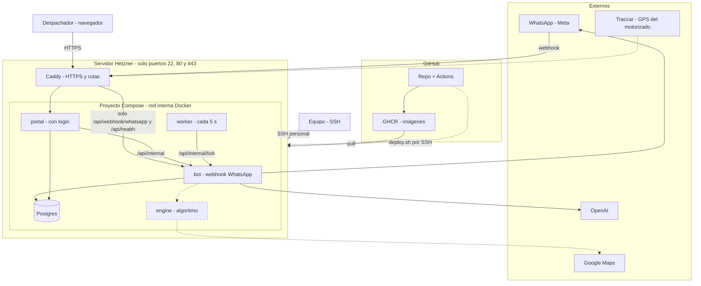
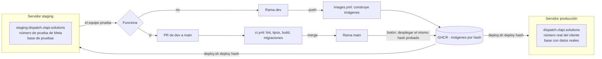
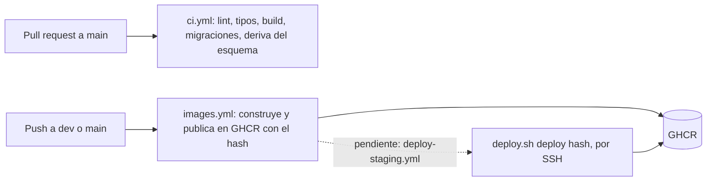

# Infraestructura

Todo corre en un VPS de Hetzner, sin Vercel. Este documento describe **qué hay y por qué**. Cómo operarlo (entrar, desplegar, cambiar secretos) está en [`OPERACION.md`](OPERACION.md); el algoritmo de asignación, en [`ALGORITMO.md`](ALGORITMO.md).

## Estado

| Pieza | Estado |
|---|---|
| Servidor de staging (Hetzner, OpenTofu) | Hecho |
| HTTPS automático (Caddy + Let's Encrypt) | Hecho |
| Portal con login, bot, worker, Postgres | Hecho, funcionando en staging |
| Migraciones versionadas (Drizzle) | Hecho |
| CI (lint, tipos, build, migraciones) | Hecho, corre en PR hacia `main` |
| Publicación de imágenes en GHCR | Hecho, en cada push a `dev` y `main` |
| Despliegue automático desde GitHub | **Pendiente** (hoy se despliega a mano, ver `OPERACION.md`) |
| Servidor de producción (separado de staging) | Pendiente |
| Backups | Pendiente (desactivados a propósito por ahora) |
| Motor de asignación (`engine`) y GPS | Pendiente |

## Arquitectura de un entorno

Staging y producción tienen **esta misma estructura**, cada uno en su propio servidor. Por eso se dibuja una sola vez; más abajo se ve cómo se relacionan los dos.

Las líneas y cajas punteadas son lo que falta. Cada entorno usa su propio número de WhatsApp, su propia base y su propio `.env`. El restaurante y el motorizado solo hablan con WhatsApp.

## Entornos y flujo de cambios

Dos servidores distintos, con la misma estructura y nada compartido (ni base, ni secretos, ni número de WhatsApp). Cada rama lleva a un entorno.

| | Staging | Producción |
|---|---|---|
| Rama | `dev` | `main` |
| Servidor | Hetzner CX23 (existe) | Otro Hetzner (pendiente: `infra/prod`) |
| Portal / bot | `staging.dispatch…` / `bot.staging.dispatch…` | `dispatch…` / `bot.dispatch…` |
| WhatsApp | Número de prueba de Meta | Número real del cliente |
| Datos | De prueba, se pueden borrar | Reales, con backups |
| Cómo se despliega | Automático al push (pendiente; hoy a mano) | Por botón, con un hash ya probado en staging |
| Quién entra por SSH | Todo el equipo | Solo quien lo necesite |

Reglas del flujo:
- **Lo que llega a producción es la misma imagen que se probó en staging**: se despliega el hash, no se reconstruye.
- Todo cambio pasa primero por `dev` y staging. Nada va directo a `main`.
- Las migraciones corren antes de cambiar las apps; si fallan, no se toca nada y se mantiene la versión anterior.
- Volver atrás es desplegar el hash anterior en el entorno que corresponda.

## Servicios

| Servicio | Qué hace | Imagen |
|---|---|---|
| `caddy` | HTTPS, enruta por dominio. Único con puertos publicados | `caddy:2-alpine` |
| `bot` | Webhook de WhatsApp, extracción con OpenAI, lógica de pedidos. Expone `/api/internal/*` solo a la red interna | `dispatch-bot` |
| `portal` | Tablero del despachador (Next.js) con login | `dispatch-portal` |
| `worker` | Cada 5 s llama a `/api/internal/tick`: asigna pendientes y notifica. Reemplaza el polling del portal | `dispatch-worker` |
| `postgres` | Base de datos, volumen `pgdata` | `postgres:17-alpine` |
| `migrate` | Solo al desplegar: aplica las migraciones y termina | `dispatch-migrate` |

Todas las imágenes propias son `ghcr.io/clapi-labs/dispatch-*:<hash del commit>` (públicas). Nunca se despliega `latest`. Los contenedores tienen `restart: unless-stopped`, healthchecks y límite de memoria.

## Decisiones

### Hosting
- **Un VPS de Hetzner, fuera de Vercel.** El receptor de GPS necesita un proceso siempre encendido, y los pendientes no pueden depender de una pestaña abierta del portal.
- **CX23** (2 vCPU, 4 GB, ~6,49 €/mes). Suficiente sin OSRM. Se sube de plan sin reinstalar.
- **Región `nbg1` (Núremberg).** El CX23 solo existe en Europa; en Ashburn solo hay CPX, más caros. La latencia no importa: cada mensaje espera a Meta y OpenAI.
- **Dominios** (DNS en GoDaddy, registros A a la IP del servidor):

  | Entorno | Portal | Bot |
  |---|---|---|
  | Staging | `staging.dispatch.clapi.solutions` | `bot.staging.dispatch.clapi.solutions` |
  | Prod (futuro) | `dispatch.clapi.solutions` | `bot.dispatch.clapi.solutions` |

- **Node 22.23.4** y **Next 16.4.2** fijados (`.nvmrc`, `Dockerfile`).

### Entornos
- **Staging y producción son servidores separados.** Cada uno con su Postgres, su `.env`, su número de WhatsApp y su estado de OpenTofu (`infra/staging`, `infra/prod`). Un error o una prueba en staging no puede afectar a producción.
- Staging usa un número de prueba de Meta, nunca el del cliente.
- Producción se crea copiando `infra/staging`; ver `OPERACION.md`.

### Infraestructura como código (`infra/`)
- **OpenTofu** con el proveedor `hetznercloud/hcloud` (OpenTofu y no Terraform: misma sintaxis, licencia abierta).
- `infra/modules/server`: servidor, firewall, IP fija, llave de despliegue y `cloud-init`. `infra/staging`: los valores de ese entorno; prod será otra carpeta con su propio estado.
- **`cloud-init`** deja el servidor listo al primer arranque: un usuario por administrador, SSH endurecido, Docker, fail2ban, swap y límites de logs de Docker.
- `ignore_changes` en `user_data`, imagen y llaves: cambiar esos datos en el código nunca recrea el servidor.
- **La infraestructura la toca una sola persona**: el token de Hetzner y `terraform.tfstate` viven en su equipo (el estado no se sube al repo). El resto del equipo cambia el repo y entra por SSH.

### Seguridad de red y acceso
- **Firewall de Hetzner**, no `ufw`: Docker escribe sus propias reglas y se salta `ufw`. Solo 22, 80 y 443.
- SSH solo con llave, un usuario por persona (`infra/access/admins.json`), sin `root` ni contraseña, grupo `dispatch-admins`.
- **Llave de despliegue restringida**: la cuenta `deploy` solo puede ejecutar `/opt/dispatch/deploy.sh` (`command="..."` en `authorized_keys`), que a su vez solo acepta `deploy <sha>`. `deploy.sh` pertenece a root: esa cuenta no puede modificarlo.
- En Caddy, el bot expone solo `/api/webhook/whatsapp` y `/api/health`. `/api/internal/*` queda dentro de la red de Docker.
- Webhook de WhatsApp con verificación de firma. Portal con login (scrypt, cookie firmada de 12 h, 5 intentos por correo e IP).
- Cabeceras de seguridad en Caddy (HSTS, nosniff, referrer, sin `Server`).

### Secretos
- Viven **solo** en `/opt/dispatch/.env` del servidor (dueño `deploy`, grupo `docker`, permisos 660). No hay gestor externo.
- Se cambian con `set-secret.sh`, que pide el valor oculto: no queda en el historial ni en el chat.
- Las apps leen las variables al arrancar: tras cambiar un secreto hay que **redesplegar**.
- El token de Hetzner y la llave privada de despliegue están solo en el equipo del administrador.
- Nada de esto va al repo. Si un secreto se filtra, se rota; borrarlo del historial no basta.

| Variable | Para qué |
|---|---|
| `POSTGRES_PASSWORD` | Contraseña de la base |
| `INTERNAL_SECRET` | Autentica las llamadas internas (`x-internal-secret`) |
| `SESSION_SECRET` | Firma las sesiones del portal (cambiarlo las cierra todas) |
| `WHATSAPP_PHONE_NUMBER_ID`, `WHATSAPP_ACCESS_TOKEN`, `WHATSAPP_APP_SECRET`, `WHATSAPP_VERIFY_TOKEN` | WhatsApp Cloud API |
| `OPENAI_API_KEY` | Extracción de pedidos |
| `BOT_ACTIVE` | `true` para que el bot responda |
| `PORTAL_HOST`, `BOT_HOST`, `ACME_EMAIL`, `REGISTRY` | Dominios, correo de Let's Encrypt, registro de imágenes |

### Despliegue
- **Por hash de commit**: `deploy.sh deploy <sha>` descarga el `compose.yml` y el `Caddyfile` de *ese* commit, baja las imágenes, aplica migraciones **antes** de tocar las apps (si fallan, no cambia nada), arranca con `up --wait` y, si algo no queda sano, vuelve solo a la versión anterior.
- Un solo despliegue a la vez (`flock`). La versión activa queda en `/opt/dispatch/.tag`.
- Volver atrás es desplegar el hash anterior.
- Staging usa este despliegue simple (las apps se recrean en segundos). El azul/verde sin corte queda para prod.
- Las migraciones deben ser compatibles con la versión anterior de la app (cambios en dos pasos), porque corren antes del cambio.

### CI/CD

| Workflow | Cuándo corre | Qué hace |
|---|---|---|
| `ci.yml` | PR hacia `main` y push a `main` | Lint, typecheck, build, migraciones sobre base vacía aplicadas dos veces, comprueba que `schema.ts` no tenga cambios sin migración y corre el seed |
| `images.yml` | Push a `dev` y `main`, o manual | Construye `bot`, `portal`, `migrate`, `worker` y los publica en GHCR con el hash y el nombre de la rama |
| `deploy-staging.yml` | **No existe aún** | Pendiente: al terminar `images.yml` en `dev`, ejecutar `deploy` por SSH con la llave restringida |

La marca del portal (`NEXT_PUBLIC_*`) se incrusta al construir la imagen, desde las variables del repositorio `CLIENT_NAME`, `CLIENT_INITIALS` y `CLIENT_COLOR`. Dependabot propone actualizaciones con espera de 7 días.

Plan de prod: despliegue por botón (`workflow_dispatch`) con un hash ya probado en staging, sin reconstruir la imagen.

## Lo que falta

1. Workflow de despliegue automático a staging (requiere guardar la llave de despliegue y la huella del servidor en los secretos de GitHub).
2. Servidor de producción aparte (`infra/prod`) y despliegue azul/verde.
3. Backups: los de Hetzner (~20 % del costo del servidor) y un `pg_dump` diario fuera del servidor. Hoy **no hay ninguno**.
4. Copia de seguridad de `terraform.tfstate`; sin él OpenTofu no sabe qué recursos le pertenecen.
5. Token permanente de WhatsApp (usuario del sistema); el de pruebas dura ~24 h.
6. Motor de asignación y receptor de GPS (ver `ALGORITMO.md`).
7. Datos de ubicación: autorización por escrito (Ley 1581 de 2012) y retención definida antes de usar GPS real.
