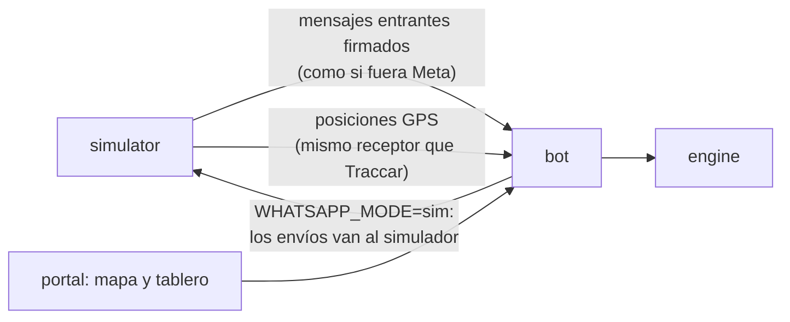
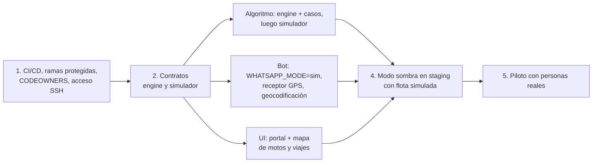

# Plan de trabajo

Próximos pasos del proyecto y cómo se reparte el equipo. Contexto técnico en [`INFRAESTRUCTURA.md`](INFRAESTRUCTURA.md), [`OPERACION.md`](OPERACION.md) y [`ALGORITMO.md`](ALGORITMO.md).

## Frentes

1. **Algoritmo + simulador de flota** conectados al sistema en staging.
2. **Bot:** sistematizar la recepción de datos y direcciones.
3. **UI/UX** del portal.
4. **CI/CD completo** y acceso del equipo (transversal).

## 1. Simulador de flota en staging

Para probar el sistema antes de lanzarlo con personas y tráfico real, sin depender de números de WhatsApp reales para cada motorizado.

**Problema:** Meta solo entrega mensajes a números reales, así que los motorizados simulados no pueden hablar por WhatsApp. El simulador **reemplaza a WhatsApp**, no lo usa.

- **En el bot:** interruptor `WHATSAPP_MODE = meta | sim`. En `sim`, lo que el bot enviaría a Meta va al simulador. Un solo punto de cambio (`services/whatsapp/client.ts`). En producción siempre es `meta`.
- **Restaurantes simulados:** generan pedidos con direcciones reales de Cali, con más volumen en hora pico. Escriben al bot por el mismo webhook, así que se prueban el bot y OpenAI de verdad.
- **Motorizados simulados:** reciben la ficha, se mueven por calles reales (rutas de OSRM o Google) a velocidad realista, envían su posición por el mismo camino que usará el GPS real y pulsan «Entregado» al llegar. Se les puede dar comportamiento: tardar en responder, quedarse sin señal, desconectarse.
- **Escenarios con semilla:** «martes pico, 12 motos, 80 pedidos/h» da siempre la misma secuencia, para comparar versiones del algoritmo con los mismos datos.
- **Modo mixto:** flota simulada + alguien del equipo escribiendo desde su WhatsApp real como restaurante.
- El engine recibe posiciones del simulador igual que las recibirá de motos reales: si funciona aquí, funciona con GPS real.

El simulador vive solo en staging y no tiene puerto público.

## 2. Bot: datos y direcciones

A investigar y discutir en equipo. Puntos de partida:

- **El algoritmo necesita coordenadas, no texto.** Hoy se guarda la dirección como texto y la zona por palabras clave. Sin latitud/longitud, el engine no sirve. Es el punto que une el bot con el algoritmo.
- **Restaurantes registrados:** su punto de recogida ya tiene coordenadas; no se pregunta.
- **Dirección del cliente:** geocodificar la nomenclatura de Cali (`Cra 15 # 32-10, barrio X`) con Google; si la confianza es baja, pedir la ubicación de WhatsApp o confirmar con «¿es aquí?».
- **Herramientas de WhatsApp:** Flows (formularios dentro del chat), listas y botones (efectivo / transferencia); texto libre con OpenAI como respaldo.
- **Clientes frecuentes:** reutilizar direcciones ya geocodificadas por teléfono.

## 3. CI/CD y acceso

| Paso | Qué |
|---|---|
| `ci.yml` | Correr también en PR hacia `dev`, no solo hacia `main` |
| Deploy a staging | Automático cuando `images.yml` termina en verde en `dev`, con la llave restringida (requiere guardar la llave y la huella del servidor en los secretos de GitHub) |
| Deploy a prod | Botón (`workflow_dispatch`) con aprobación, reutilizando el hash probado en staging |
| Protección de ramas | `main` y `dev` sin push directo: siempre por PR con CI en verde. Mergear a `dev` = desplegar a staging |
| SSH del equipo | Llave `.pub` → `infra/access/admins.json` → `sync-admins.sh` (ver `OPERACION.md`). Para desplegar no hace falta SSH |

## Equipo: quién hace qué

| Persona | Zona | Carpetas |
|---|---|---|
| Infra (David) | Infraestructura, CI/CD y bot | `infra/`, `deploy/`, `.github/`, `apps/bot/` |
| UI/UX | Portal | `apps/portal/` |
| Algoritmo | Engine y simulador | `apps/engine/`, `apps/simulator/` |

Cada uno revisa los PR de su zona (`CODEOWNERS`).

### Reglas para no chocar

1. Cada tarea en su rama desde `dev` (`feat/…`), PR pequeño hacia `dev`. Nadie hace push directo.
2. **Contratos antes que código.** Se acuerdan primero y se versionan en `docs/`:
   - bot ↔ engine: JSON de `POST /evaluar` (borrador en `ALGORITMO.md`);
   - bot ↔ simulator: formato de mensajes y de posiciones GPS;
   - portal ↔ bot: rutas internas.

   Con el contrato fijo, cada uno avanza sin esperar al otro.
3. **`packages/shared/src/db/schema.ts` es zona compartida.** Quien cambie el esquema avisa, una migración por PR, y rebase antes de `npm run db:generate`.
4. **Staging es de todos:** tiene lo último mergeado en `dev`. Si alguien necesita staging quieto para una prueba, avisa.
5. Reunión corta semanal: contratos y lo que pasa a `main`.

## Orden

